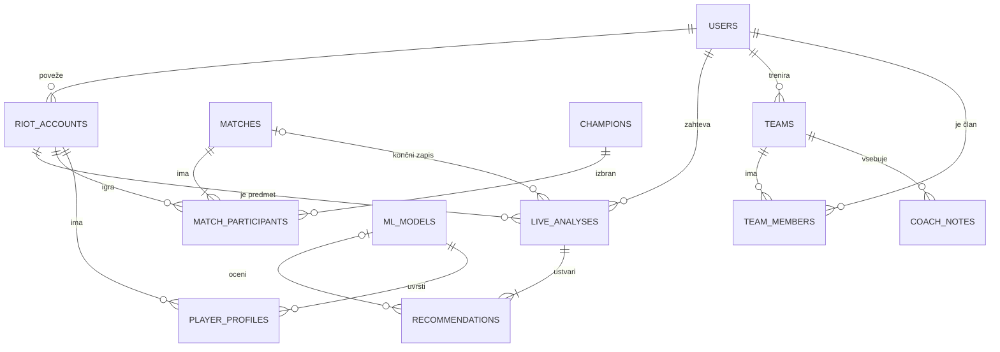

# 03 – Podatkovni model

Baza je **PostgreSQL** (relacijski model). Polja, katerih obliko določa Riot ali ki so izračunani rezultati, so shranjena kot `JSONB`.

## Entitete in glavna polja

| Entiteta | Glavna polja | Namen |
|---|---|---|
| **users** | id, email, password_hash, role (player/coach/admin), explanation_level | uporabniki aplikacije |
| **riot_accounts** | puuid (PK), game_name, tag_line, platform, user_id (FK, nullable), verified_at, profile_public | Riot računi – naših uporabnikov in igralcev iz tekem |
| **champions** | id, name, damage_profile, cc/healing/engage/burst/tank (0–3), power_spikes (jsonb) | baza znanja o šampionih |
| **items** | id, name, cost, tags (npr. anti_heal, armor_pen) | baza znanja o predmetih |
| **matches** | match_id (PK), patch, queue_id, duration_s, winning_team | odigrane tekme (nespremenljive) |
| **match_participants** | match_id + puuid (PK), champion_id, position, kills/deaths/assists, items, win, features (jsonb: CS@10, zlato @15, roaming, smrti pred 14. min) | statistika in značilke igralca v tekmi – učni podatki |
| **player_profiles** | id, puuid (FK), role, archetype, scores (jsonb), confidence, model_id (FK) | profil igralnega sloga |
| **live_analyses** | id, user_id (FK, nullable), puuid (FK), game_id, status, participants (jsonb), enemy_comp (jsonb), match_id (FK, nullable) | analiza aktivne tekme |
| **recommendations** | id, analysis_id (FK), variant, item_path (jsonb z razlogi), runes, matchup (jsonb), model_id (FK, nullable) | 2–3 variante builda za analizo |
| **ml_models** | id, kind (build_ranker/playstyle_clusters), version, patch, metrics (jsonb), status (trained/active) | verzije naučenih modelov |
| **teams** | id, name, coach_id (FK) | ekipe trenerjev |
| **team_members** | team_id + user_id (PK), status (invited/active) | člani ekipe |
| **coach_notes** | id, team_id (FK), player_id (FK), body, due_date | zapiski in naloge trenerja |

Agregati za model in primerjave (`build_stats`, `role_rank_baselines`) se izračunajo ponoči iz `match_participants`.

## Povezave

- users 1 : N riot_accounts
- matches 1 : N match_participants N : 1 riot_accounts
- riot_accounts 1 : N player_profiles
- users 1 : N live_analyses, riot_accounts 1 : N live_analyses
- live_analyses 1 : N recommendations
- live_analyses N : 0..1 matches (pregled po tekmi)
- ml_models 1 : N recommendations, ml_models 1 : N player_profiles
- users (trener) 1 : N teams, teams N : M users prek team_members, teams 1 : N coach_notes

## Osnutek

`items` niso povezani s tujim ključem – v `match_participants` in `recommendations` so shranjeni kot seznam ID-jev.