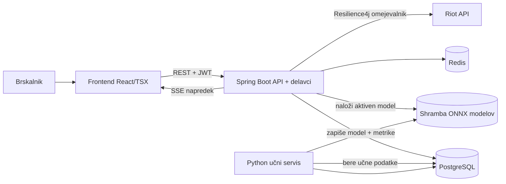
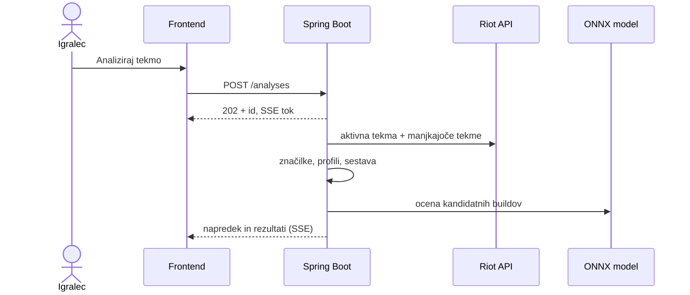

# 04 – Arhitektura in tehnološki sklad (različica z Javo)

Alternativa k osnovni različici s Pythonom. Funkcionalnosti in podatkovni model ostanejo enaki, spremeni se backend: API in delavci so v Javi (Spring Boot), učenje modelov ostane v Pythonu, napoved pa teče v Javi prek formata ONNX.

## Arhitektura

### Glavni deli sistema

| Del | Odgovornost |
|---|---|
| **Frontend** (React + TypeScript/TSX, Next.js) | uporabniški vmesnik, prikaz analize in napredka v živo |
| **API in delavci** (Spring Boot, Java 21) | REST API, avtentikacija, vloge, analiza aktivne tekme, klici Riot API, napoved modelov |
| **Učni servis** (Python) | nočno učenje modelov (LightGBM, Gaussian Mixture) in izvoz v ONNX |
| **PostgreSQL** | trajni podatki in metapodatki modelov (`ml_models`) |
| **Redis** | vrsta nalog, predpomnilnik, kanal napredka |
| **Shramba modelov** | mapa ali S3-združljiva shramba (MinIO) z ONNX datotekami |
| **Zunanji viri** | Riot Games API in Data Dragon |

### Diagram



### Komunikacija

- Frontend ↔ API: REST z JSON, TypeScript tipi se generirajo iz OpenAPI (springdoc-openapi).
- API analize ne izvaja v zahtevku: nalogo da v vrsto (Redis), vrne `202`, napredek pošilja prek `SseEmitter`.
- Riot API kliče samo Java servis prek `WebClient`, omejevanje in ponovne poskuse ureja Resilience4j.
- Java in Python servis ne kličeta drug drugega neposredno: povezuje ju baza (učni podatki, `ml_models`) in shramba modelov.

### Netrivialna procesa

**Analiza aktivne tekme:** enaka kot v osnovni različici: Spectator-V5 → prioritetni zajem tekem → profili in sestava → napoved modela v Javi (ONNX Runtime) → postopni prikaz rezultatov.



**Učni cevovod (ponoči):** Spring `@Scheduled` naloga zbere tekme → Python servis izračuna značilke, nauči modela, ju izvozi v ONNX in zapiše metrike v `ml_models` → administrator aktivira verzijo → Java servis jo naloži brez ponovnega zagona.

**Ključno tveganje:** značilke za učenje (Python) in za napoved (Java) morajo biti izračunane popolnoma enako. Zato je definicija značilk shranjena v eni skupni datoteki (JSON shema), oba servisa pa imata teste na istih testnih tekmah, ki preverijo, da dobita enake vrednosti.

### Podatkovna baza

PostgreSQL z migracijami Flyway, dostop prek Spring Data JPA (Hibernate). Model je enak kot v `03-podatkovni-model.md`.

### Avtentikacija

- Spring Security, gesla z Argon2id, kratkoživ JWT + osvežilni žeton v `HttpOnly` piškotku.
- Vloge (player, coach, admin) z `@PreAuthorize`, dostop do podatkov ekipe preverja servisna plast.
- Riot račun se poveže z verifikacijo profilne ikone.

### Lokalni zagon

```bash
cp .env.example .env              # RIOT_API_KEY ali RIOT_API_MODE=fixtures
docker compose up -d postgres redis minio
./gradlew bootRun                 # ali Run v IntelliJ
cd frontend && pnpm dev
cd trainer && uv run train.py     # po potrebi, ročno učenje modela
```

Frontend: `http://localhost:3000`, API dokumentacija: `http://localhost:8080/swagger-ui.html`.

## Tehnološki sklad

| Področje | Tehnologije |
|---|---|
| Frontend | React, TypeScript (TSX), Next.js, Tailwind CSS, shadcn/ui, TanStack Query, Recharts |
| Backend | Java 21, Spring Boot, Spring Web, Spring Security, Spring Data JPA, Flyway, Resilience4j |
| ML učenje | Python, LightGBM, scikit-learn, Polars, izvoz v ONNX (onnxmltools / skl2onnx) |
| ML napoved | ONNX Runtime za Javo |
| Podatkovna baza | PostgreSQL, Redis, MinIO (modeli) |
| Lokalni razvoj | IntelliJ IDEA, Gradle, Docker Compose, pnpm, uv |
| Testiranje | JUnit 5, Testcontainers, Vitest, pytest, Playwright |
| CI/CD | GitHub Actions (ločena opravila za Javo, Python in frontend), GitHub Container Registry |

## Arhitekturne odločitve

| Odločitev | Utemeljitev |
|---|---|
| Java (Spring Boot) za backend | zrel ekosistem za varnost, transakcije in dolgotrajne storitve; tipna varnost na strežniku |
| Učenje v Pythonu, napoved v Javi (ONNX) | Python ima najboljša orodja za učenje, ONNX omogoči hitro napoved v Javi brez klica dodatnega servisa |
| Skupna definicija značilk | prepreči razhajanje med učenjem in napovedjo (training/serving skew) |
| Resilience4j za Riot API | preverjen omejevalnik in ponovni poskusi namesto lastne implementacije |
| Servisa povezana prek baze in shrambe | Java in Python sta neodvisna, učenje lahko pade brez vpliva na delovanje aplikacije |
| Testcontainers | integracijski testi s pravo PostgreSQL in Redis bazo |
| Ostalo kot v osnovni različici | uradni Riot API, asinhrona analiza, več variant builda, SSE |