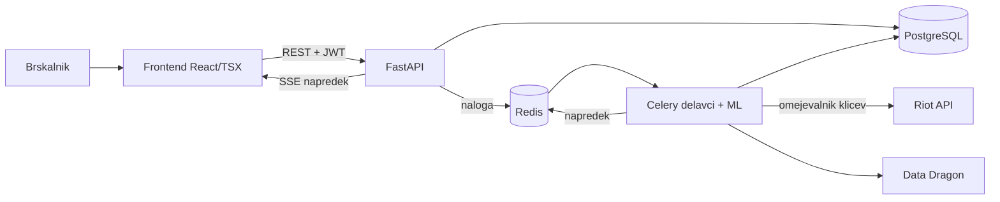
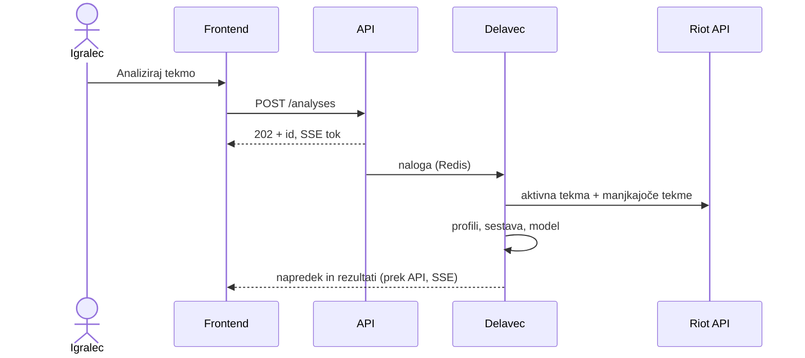

# 04 – Arhitektura in tehnološki sklad

## Arhitektura

### Glavni deli sistema

| Del | Odgovornost |
|---|---|
| **Frontend** (React + TypeScript/TSX, Next.js) | uporabniški vmesnik, prikaz analize in napredka v živo |
| **API** (FastAPI) | REST API, avtentikacija, vloge, ustvarjanje analiz, tok napredka (SSE) |
| **Delavci** (Celery) | klici Riot API, značilke, napovedi modelov, nočno zbiranje tekem in učenje |
| **ML modul** (Python) | model priporočil (LightGBM) in model arhetipov (Gaussian Mixture) |
| **PostgreSQL** | trajni podatki |
| **Redis** | vrsta nalog, omejevanje klicev Riot API, predpomnilnik, kanal napredka |
| **Zunanji viri** | Riot Games API (Account, Spectator, Match, League) in Data Dragon |

### Diagram



### Komunikacija

- Frontend ↔ API: REST z JSON, TypeScript tipi se generirajo iz OpenAPI specifikacije.
- API analize ne izvaja sam: ustvari zapis, nalogo da v vrsto (Redis) in vrne `202` z ID analize.
- Delavec objavlja napredek v Redis, API ga prek SSE pošilja frontendu.
- Riot API kliče samo delavec; API ključ je le v okolju strežnika.

### Netrivialna procesa

**Analiza aktivne tekme:** Spectator-V5 vrne 10 udeležencev → delavec po prioriteti (linijski nasprotnik, jungler, ostali) prenese manjkajoče tekme → profili in sestava → model oceni builde → rezultati se prikazujejo postopoma. Pri približno 70 klicih in omejitvi 100 klicev / 2 min je zato analiza asinhrona; tekme se shranijo in nikoli več ne prenašajo.



**Učni cevovod (ponoči):** zbiranje rangiranih tekem → značilke → učenje obeh modelov → metrike (AUC, log loss) v `ml_models` → administrator aktivira novo verzijo. Ko za šampiona ni dovolj podatkov, priporočila naredijo rezervna pravila. Razlogi za predmete izhajajo iz SHAP prispevkov modela.

### Podatkovna baza

PostgreSQL z migracijami (Alembic), Redis za vrsto in predpomnilnik. Model v `03-podatkovni-model.md`.

### Avtentikacija

- E-pošta in geslo (Argon2id), kratkoživ JWT + osvežilni žeton v `HttpOnly` piškotku.
- Vloge (player, coach, admin) se preverjajo na API.
- Riot račun se poveže z verifikacijo profilne ikone (Riot Sign On zahteva produkcijski ključ).

### Lokalni zagon

```bash
cp .env.example .env        # RIOT_API_KEY ali RIOT_API_MODE=fixtures
docker compose up -d --build
docker compose exec api alembic upgrade head
```

Frontend: `http://localhost:3000`, API dokumentacija: `http://localhost:8000/docs`. Način `fixtures` uporablja posnete Riot odgovore, zato razvoj in testi delujejo brez ključa.

## Tehnološki sklad

| Področje | Tehnologije |
|---|---|
| Frontend | React, TypeScript (TSX), Next.js, Tailwind CSS, shadcn/ui, TanStack Query, Recharts |
| Backend | Python, FastAPI, SQLAlchemy, Alembic, Celery |
| ML | LightGBM, scikit-learn, Polars |
| Podatkovna baza | PostgreSQL, Redis |
| Avtentikacija | JWT, Argon2id |
| Lokalni razvoj | Docker Compose, pnpm, uv, ESLint, Ruff |
| Testiranje | Vitest, pytest, Playwright |
| CI/CD | GitHub Actions (lint, testi, gradnja Docker slik), GitHub Container Registry |

## Arhitekturne odločitve

| Odločitev | Utemeljitev |
|---|---|
| TypeScript (TSX) na frontendu | tipna varnost, tipi generirani iz API, poznan sklad |
| Python za backend | ML (LightGBM, scikit-learn) in API v istem jeziku, brez ločenega ML servisa |
| Uradni Riot API namesto op.gg | op.gg nima javnega API, strganje krši pogoje in pravila Riot |
| Asinhrona analiza z delavci | omejitev Riot API ne dovoli, da bi analiza tekla v enem HTTP zahtevku |
| Shranjevanje tekem | tekme so nespremenljive; manj klicev in hkrati učni podatki za model |
| ML v MVP, pravila kot rezerva | model najde povezave, ki jih pravila ne; pravila pokrijejo šampione z malo podatki |
| Več variant builda | pravila Riot prepovedujejo aplikacije, ki narekujejo odločitve |
| SSE namesto WebSocketov | napredek teče samo v eno smer, SSE je preprostejši |