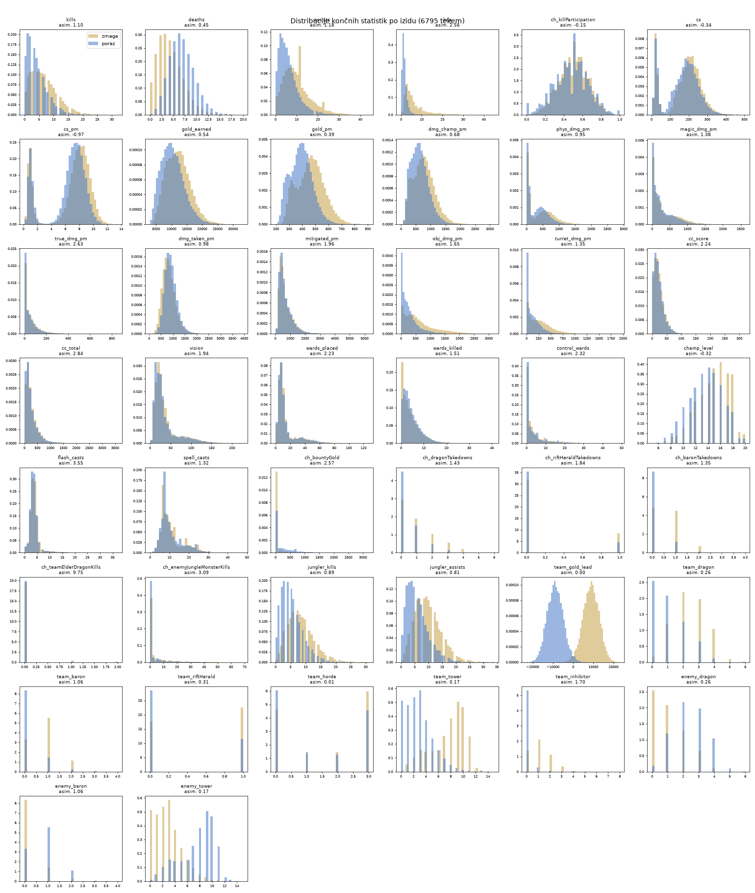
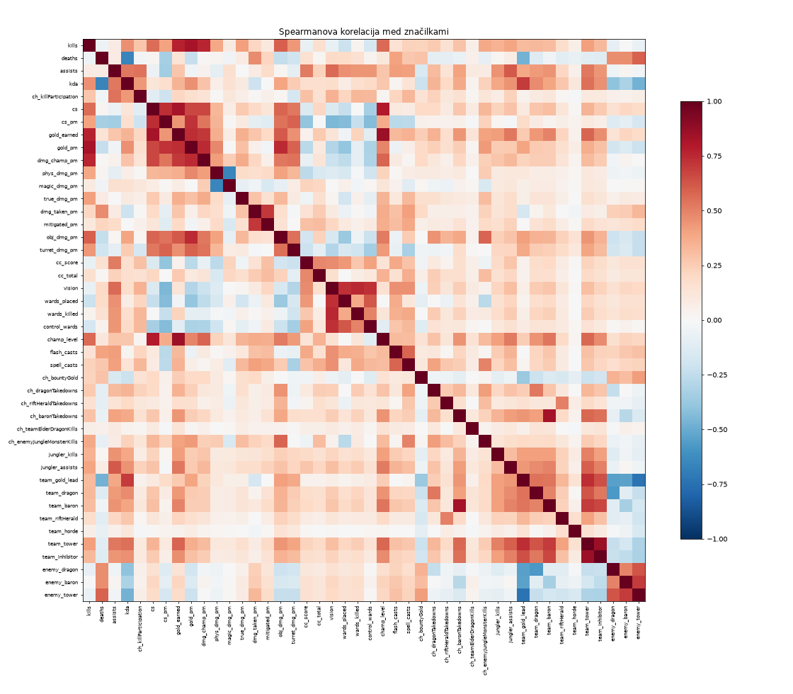
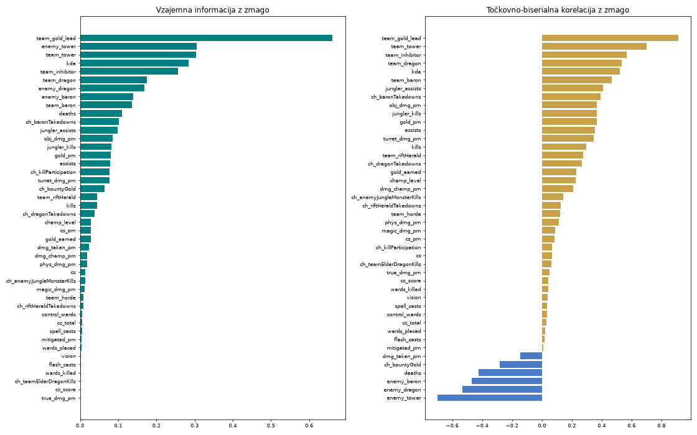

# Ugotovitve – model za priporočanje buildov (testna evidenca)

Evidenca poskusov z modelom strojnega učenja za US-04 (priporočilo builda glede na nasprotno sestavo).
Vsak poskus ima: podatke, kaj napovedujemo, značilke, algoritme, način vrednotenja, rezultat in zaključek.
Novi poskusi se dodajajo na konec, starejši se ne spreminjajo.

## Izhodišče

**Kaj model napoveduje:** verjetnost zmage igralca (`win`) glede na njegovega šampiona, vlogo,
nasprotno sestavo in dokončane predmete. Ob analizi model oceni kandidatne builde (najpogostejša
jedra s 3 predmeti za šampiona) in jih razvrsti po oceni. Verjetnost ni obljuba zmage, uporablja se
samo za razvrščanje (ADR-0006).

**Pogoj za vklop (ADR-0006):** model se aktivira samo, če ima višji AUC od izhodiščnega modela brez
značilk sestave. Sicer aplikacija uporablja priporočila po pravilih (`RuleBasedRecommender`).

**Metrika:** ROC AUC (0,5 = ugibanje, 1,0 = popolna napoved).

**Podatki:** rangirane tekme challenger igralcev na EUW (League-V4 + Match-V5), patch 16.22.
Uporabljajo se samo tekme, dolge vsaj 15 minut (krajše so remake ali zgodnja predaja).

## Pregled modelov v bazi (`ml_models`)

| Verzija | Datum | Tekem | AUC | Izhodišče brez sestave | Stanje |
|---|---|---|---|---|---|
| v1 | 2026-11-08 | 287 | 0,517 | 0,550 | neaktiven |
| v2 | 2026-11-08 22:50 | 1107 | 0,526 | 0,564 | neaktiven |
| v3 | 2026-11-08 23:01 | 1260 | 0,579 | 0,594 | neaktiven |
| v4 | 2026-11-08 23:50 | 2544 (EUW + KR) | 0,582 | 0,570 | neaktiven (glej poskus 4) |
| v5 | 2026-11-09 14:20 | 6588 (EUW + KR + NA) | 0,573 | 0,579 | neaktiven (glej poskus 5) |

Vrednotenje v1–v3: ena delitev 80/20 po tekmah (`GroupShuffleSplit`). Model: LightGBM, id šampiona in
vloga kot kategoriji, surove vsote ocen sestave (0–15), 0/1 stolpec za vsak dokončan predmet
(≥ 5 pojavitev), število dokončanih predmetov (`completed_count`).

---

## Poskus 1 – značilke po predavanjih (2026-11-08, ~23:00)

**Podatki:** 1117 tekem, 11.170 igralcev.
**Vrednotenje:** 5-kratna navzkrižna validacija `GroupKFold` po tekmah (vseh 10 igralcev ene tekme je
vedno na isti strani), povprečje ± standardni odklon.

**Spremembe značilk (iz poglavja Inženiring podatkov):**

| Tehnika | Izvedba |
|---|---|
| Visoka kardinalnost kategorij | id šampiona (~170 vrednosti) → 6 razredov (Fighter, Tank, Mage, Assassin, Marksman, Support), je/ni kodiranje + fizična/magična škoda |
| Normalizacija | vsote ocen sestave 0–15 → 0–1 (min-max po znani zalogi vrednosti) |
| Odstranitev zavajajoče značilke | `completed_count` (število predmetov je posledica dolžine tekme in zmage) |
| Gradnja značilk (domena) | profil builda: deleži oznak predmetov (armor, spell_block, health, anti_heal, tenacity, …) |
| Gradnja značilk (interakcije) | oklep × fizična škoda, MR × magična škoda, anti_heal × zdravljenje, tenacity × nadzor, zdravje × burst, prebojnost × tankovskost |
| Standardizacija v cevovodu | `make_pipeline(StandardScaler(), …)` – parametri samo iz učne množice (brez uhajanja) |
| Izbira značilk (filter) | vzajemna informacija `mutual_info_classif` |

**Rezultati (napoved zmage):**

| Model | Z značilkami sestave | Brez | Prispevek sestave |
|---|---|---|---|
| LightGBM, trenutne značilke | 0,560 ± 0,010 | 0,580 | −0,020 |
| LightGBM, brez `completed_count` | 0,526 ± 0,015 | 0,564 | −0,038 |
| LightGBM, nove značilke | 0,535 ± 0,023 | 0,572 | −0,037 |
| LightGBM, nove značilke, regulariziran | 0,540 ± 0,009 | 0,579 | −0,039 |
| Logistična regresija + StandardScaler | 0,517 ± 0,023 | 0,532 | −0,016 |
| Nevronska mreža MLP 32-16 + StandardScaler | 0,525 ± 0,016 | 0,551 | −0,027 |

Vzajemna informacija: vse značilke ≤ 0,013 (na ravni šuma ocenjevalnika).

**Dodatno – napoved nakupa predmeta** (ali iz sestave lahko napovemo, kaj challengerji kupijo):
nakup je skoraj v celoti določen s šampionom (AUC 0,91–0,997 za 25 najpogostejših predmetov);
sestava doda od −0,005 do +0,001.

**Zaključek:** sestava v vseh kombinacijah napoved poslabša. Razpršenost čez delitve (±0,01–0,02) je
večja od razlik med v1 in v2, zato ena delitev ni zanesljiva ocena. Nevronska mreža ni izbrana
(slabša od LightGBM; po predavanju se velike mreže na majhnih množicah pretrenirajo).

---

## Poskus 2 – več ciljev, značilk in algoritmov (2026-11-08, ~23:10)

**Podatki:** 1260 tekem, 12.600 igralcev. **Vrednotenje:** `GroupKFold` 5.

**Algoritmi:** logistična regresija, naivni Bayes, kNN (k = 101), naključni gozd, ExtraTrees,
HistGradientBoosting, LightGBM (regulariziran), MLP 16 (L2 0,1), MLP 64-32 (L2 0,05).
Pri nevronskih mrežah: StandardScaler v cevovodu, L2 regularizacija in zgodnja ustavitev
(sklearn nima dropouta).

**Nove značilke:** ciljno kodiranje šampiona (zglajen win rate, izračunan **samo na učnem foldu**),
sestava lastne ekipe, razlika med ekipama, deleži razredov v ekipi.

| Naloga | Značilke | Najboljši AUC | Algoritem |
|---|---|---|---|
| Zmaga igralca | šampion | 0,512 | kNN |
| | + nasprotna sestava | 0,515 | naivni Bayes |
| | + lastna sestava in razlika | 0,528 | kNN |
| | + build in interakcije | **0,552** | ExtraTrees |
| | vse skupaj | 0,548 | HistGB |
| Zmaga ekipe (1 vrstica na ekipo) | obe sestavi | 0,531 | HistGB |
| | + win rate šampionov | 0,534 | HistGB |
| Nakup situacijskega predmeta (517 parov šampion–predmet s 15–85 % nakupov, 52.706 vrstic) | predhodna verjetnost + oznake | 0,714 | LightGBM |
| | + sestava in interakcije oznaka × sestava | 0,714 (+0,0003) | LightGBM |

MLP ni bil najboljši pri nobeni nalogi.

**Preverjanje "build pomaga":**

| Igralci | Samo šampion | + sestava + build |
|---|---|---|
| vsi (12.600) | 0,509 | 0,552 |
| ≥ 3 dokončani predmeti (6478) | 0,522 | 0,526 |
| ≥ 4 dokončani predmeti (2470) | 0,547 | 0,550 |

Zmagovalci imajo povprečno 2,77 dokončanega predmeta, poraženci 2,45.

**Zaključek:** navidezni prispevek builda je **skrito uhajanje podatkov**. Končni build je posledica
stanja tekme (kdor vodi, ima več zlata in drugačne predmete), ne vzrok zmage. Ko primerjamo igralce s
podobnim številom predmetov, prispevek izgine (+0,004). Iz teh podatkov boljšega modela ni.

---

## Poskus 3 – učna krivulja (2026-11-08, ~23:20)

**Vprašanje:** ali bi več tekem pomagalo? **Postopek:** isti testni foldi, učenje na 25/50/75/100 %
učnih tekem, LightGBM (regulariziran).

| Delež | Učnih tekem | Šampion | + nasprotna sestava | + lastna sestava | + build (≥ 3 predmeti) | Prispevek builda |
|---|---|---|---|---|---|---|
| 0,25 | 252 | 0,505 | 0,481 | 0,485 | 0,495 | +0,005 |
| 0,50 | 505 | 0,494 | 0,497 | 0,512 | 0,527 | +0,002 |
| 0,75 | 758 | 0,508 | 0,497 | 0,492 | 0,506 | +0,003 |
| 1,00 | 1011 | 0,506 | 0,491 | 0,501 | 0,516 | +0,007 |

**Zaključek:** krivulja je ravna (vse okoli 0,50 ± 0,02). V obsegu do ~1000 tekem ni zaznavnega
trenda, zato je morebitni učinek sestave manjši od šuma. Ocena potrebne količine: razliko 2 odstotnih
točk v win rateu (npr. MR predmet proti AP sestavi) zaznamo pri 2 σ šele pri ~2500 igrah na skupino
(SE = 0,5/√n), kar je za posamezen par šampion–predmet reda več deset tisoč tekem.

---

## Poskus 4 – več podatkov in druga regija (2026-11-08, ~23:50)

**Podatki:** dodaten zajem 23:18–23:48, vzporedno EUW in **KR** (Riot omejuje klice po regionalnem
usmerjevalniku: EUW → `europe`, KR → `asia`, zato dve regiji podvojita hitrost na ~2800 tekem/h).
Skupaj 2578 tekem, uporabnih 2544 (EUW 1926, KR 618), patchi 16.20 (264), 16.21 (1345), 16.22 (935).

**Model v4** (ena delitev 80/20, kot v kodi): AUC 0,582 > izhodišče 0,570 – prvič nad izhodiščem.

**Preverjanje s 5-kratno `GroupKFold`:**

| Značilke | S sestavo | Brez sestave | Prispevek sestave |
|---|---|---|---|
| kot v produkciji (v4) | 0,579 ± 0,012 | 0,578 | +0,0005 |
| brez `completed_count` | 0,548 ± 0,009 | 0,563 | −0,015 |
| nove značilke (poskus 1), regulariziran LightGBM | 0,574 ± 0,014 | 0,583 | −0,009 |
| samo EUW (1926 tekem) | 0,567 ± 0,011 | 0,579 | −0,012 |
| samo KR (618 tekem) | 0,537 ± 0,004 | 0,553 | −0,016 |

**Zaključek:** zmaga v4 nad izhodiščem je posledica ugodne delitve (prispevek +0,0005 je znotraj
šuma ±0,012). Model zato **ni aktiviran**. To pokaže slabost trenutnega pogoja za vklop: z
`--activate` bi se v4 vklopil, čeprav ni boljši – zato je zamenjava ene delitve z `GroupKFold` v kodi
(naslednji korak 4) potrebna, preden se kateri koli model aktivira. Dvig AUC na ~0,58 izvira iz
`completed_count` (uhajanje stanja tekme, poskus 2), ne iz sestave. Mešanje regij in patchev ne pomaga:
tudi ločeno po regijah sestava napoved poslabša.

---

## Poskus 5 – 6588 tekem iz treh regij, celotne metrike (2026-11-09, ~14:20)

**Podatki:** zajem 2026-11-09 13:05–14:00 vzporedno na treh regionalnih usmerjevalnikih
(EUW → `europe`, KR → `asia`, NA → `americas`; ~75 tekem/min). EUNE deli `europe` z EUW, zato
zajema ne pospeši in je bil po nekaj minutah zamenjan z NA. Skupaj 6669 tekem, uporabnih (≥ 15 min)
**6588** = 65.880 igralcev (EUW 3276, KR 1974, NA 1315, EUNE 23), patchi 16.14–16.22. Delež zmag
je točno 0,500 (vsaka tekma ima 5 zmagovalcev in 5 poražencev).

**Model v5** (`python -m app.ml`, ena delitev 80/20): AUC 0,5725 < izhodišče 0,5785 → **neaktiven**.

**Vrednotenje:** 5-kratna `GroupKFold` po tekmah (igralci iste tekme so vedno v isti delitvi), iste
značilke in parametri LightGBM kot v produkciji. Napovedi vseh delitev so združene; prag za
razred je 0,5. Naivni model (vedno 0,5) ima AUC 0,500, log loss 0,6931 in Brier 0,2500.

| Značilke | AUC (± odklon) | Log loss | Brier | Točnost | Preciznost | Priklic | F1 |
|---|---|---|---|---|---|---|---|
| vse (v5) | 0,5811 ± 0,0057 | 0,6841 | 0,2455 | 0,559 | 0,555 | 0,597 | 0,575 |
| brez sestave (izhodišče) | **0,5846 ± 0,0035** | **0,6818** | **0,2444** | **0,562** | 0,557 | 0,608 | 0,581 |
| brez `completed_count` | 0,5638 ± 0,0060 | 0,6878 | 0,2473 | 0,548 | 0,549 | 0,537 | 0,543 |
| brez `completed_count` in sestave | 0,5727 ± 0,0022 | 0,6851 | 0,2460 | 0,551 | 0,553 | 0,538 | 0,545 |
| samo šampion + položaj | 0,5148 ± 0,0048 | 0,6950 | 0,2509 | 0,510 | 0,510 | 0,507 | 0,509 |

**Matrika zmede** (65.880 igralcev, prag 0,5; vrstice = dejansko, stolpci = napovedano):

| v5 (vse značilke) | napoved poraz | napoved zmaga |
|---|---|---|
| **poraz** (32.940) | TN 17.176 | FP 15.764 |
| **zmaga** (32.940) | FN 13.264 | TP 19.676 |

| Izhodišče brez sestave | napoved poraz | napoved zmaga |
|---|---|---|
| **poraz** (32.940) | TN 16.972 | FP 15.968 |
| **zmaga** (32.940) | FN 12.898 | TP 20.042 |

Oba modela pravilno uvrstita le ~56 % igralcev. Napaki sta skoraj simetrični, z rahlim nagibom k
napovedi zmage (priklic 0,60 > preciznost 0,56).

**Po regijah** (vsaka regija posebej, 5-kratna GroupKFold):

| Regija | Igralcev | AUC vse | AUC brez sestave | Prispevek sestave |
|---|---|---|---|---|
| EUW | 32.760 | 0,5773 | 0,5828 | −0,0055 |
| KR | 19.740 | 0,5624 | 0,5670 | −0,0047 |
| NA | 13.150 | 0,5441 | 0,5601 | −0,0160 |

**Učna krivulja** (naključni podvzorci tekem, seme 7):

| Tekem | AUC vse | AUC brez sestave | Prispevek sestave |
|---|---|---|---|
| 1000 | 0,5517 ± 0,0127 | 0,5610 | −0,0093 |
| 2500 | 0,5606 ± 0,0061 | 0,5722 | −0,0116 |
| 4000 | 0,5769 ± 0,0105 | 0,5803 | −0,0034 |
| 6588 | 0,5811 ± 0,0057 | 0,5846 | −0,0036 |

**Zaključek:**

- Sestava nasprotnikov napoved še vedno rahlo **poslabša** (−0,0036 pri odklonu ±0,0057). Pri vseh
  metrikah je izhodišče brez sestave enako dobro ali boljše, zato v5 **ni aktiviran** in priporočilo
  ostane po pravilih.
- Več podatkov pomaga obema modeloma (AUC 0,55 → 0,58), negativni prispevek sestave pa se z več
  podatki manjša (−0,012 → −0,004). To pomeni, da 7 značilk sestave pri manj podatkih povzroča
  prekomerno prilagajanje, ne pa, da sestava ni pomembna. Pozitivnega učinka tudi pri 6588 tekmah ni.
- Napovedna moč prihaja skoraj v celoti iz builda: samo šampion in položaj dasta 0,515, predmeti
  dvignejo AUC na ~0,57, `completed_count` pa še za ~0,01–0,02 (uhajanje stanja tekme, poskus 2).
- Odklon med delitvami se je s 6588 tekmami zmanjšal na ±0,004–0,006 (pri 2544 tekmah ±0,012), zato
  so primerjave zdaj zanesljivejše kot v poskusih 1–4.
- Regije se ne smejo kar mešati: NA je pri enakem modelu precej slabša (0,544). Pri skupnem učenju
  je smiselno dodati regijo kot značilko.

---

## Poskus 6 – analiza podatkov končnih statistik (2026-11-09, ~15:00)

**Namen:** ugotoviti, kaj se povezuje z zmago, in tako izbrati značilke za model stanja ob
15. minuti. Postopek sledi predavanjem *Razvoj inteligentnih rešitev – 02 Inženiring podatkov in
značilnic*.

**Podatki:** končne statistike iz shranjenega JSON-a Match-V5 (`matches.raw`, brez novih klicev
API). 7238 tekem ≥ 15 min, 72.380 igralcev, 44 številskih in 5 kategoričnih značilk:
- **igralec:** KDA, kill participation, CS, zlato, škoda šampionom po vrstah, prejeta in ublažena
  škoda, škoda ciljem in stolpom, CC score, vision, wardi, level, uporabe Flasha in urokov,
  shutdowni (`bountyGold`), zmaji, herald, baron, Elder;
- **runa:** keystone, primarno in sekundarno drevo;
- **ekipa:** prednost v zlatu, cilji in kili/asistence junglerja.

> **Uhajanje izida (target leakage):** vse to so vrednosti ob **koncu** tekme. Zmagovalec uniči
> stolpe in nexus ter pri tem dobi zlato, zato značilke izid že vsebujejo. Model iz njih doseže
> AUC 0,9997 (sama prednost v zlatu 0,999), a je za priporočila med tekmo neuporaben. Analiza je
> zato **samo opisna**; napovedni model bo uporabljal samo stanje ob 15. minuti (iz časovnic).
> Delitev je pravilna (`GroupKFold` po tekmah) – visok AUC ni napaka v vrednotenju, ampak lastnost
> značilk.

### 1. Distribucije

- **Manjkajočih vrednosti ni.** Riot vedno vrne vse polje; kratke tekme (< 15 min) so izločene.
- **Desno izkrivljene** (asimetrija > 1) so skoraj vse števne značilke: KDA 2,56, CC 2,24–2,84,
  vision 1,94, wardi 2,2, Flash 3,55, bounty 2,57, Elder 9,75. Po predavanjih: **sqrt** za rahlo
  (kills 1,10 → −0,14, assists 1,18 → −0,01, turret škoda 1,35 → 0,12) in **log1p** za močno
  izkrivljene (KDA 2,56 → 0,59, ublažena škoda 1,96 → 0,07, vision 1,94 → 0,39). Pri drevesih
  (LightGBM) transformacija ni potrebna, pri logistični regresiji in MLP pa je.
- **Osamelci** (IQR): največ pri `cs_pm` (19,6 % – podporniki in junglerji imajo drugačno
  porazdelitev), wardih (14,7 %) in Flashu (15,1 %). To niso napake, ampak vloge → položaj
  mora biti značilka, ne pa razlog za brisanje.
- **Veliko ničel:** bounty 69 %, Elder 99 %, herald 84 % – binarizacija (je/ni) je pri teh
  smiselnejša od števila.
- **Kategorične:** 173 šampionov (le 1 z manj kot 30 primeri), 17 keystonov, 5 položajev.

### 2. Korelacije med značilkami

Pari z |Spearman| > 0,8 (odvečne, iz para zadošča ena):

| Značilka A | Značilka B | Pearson | Spearman |
|---|---|---|---|
| zlato | level | 0,83 | 0,86 |
| stolpi ekipe | inhibitorji ekipe | 0,82 | 0,85 |
| baron (igralec) | baron (ekipa) | 0,84 | 0,83 |
| CS | zlato | 0,77 | 0,83 |
| kili | zlato/min | 0,80 | 0,82 |

**PCA:** prva komponenta (zlato, level, stolpi, kili, škoda ciljem) pojasni 21 % variance; za 90 %
jih je potrebnih 21 od 44. Značilke so torej v veliki meri različne – sklop „kdo je spredaj“ je
največji skupni dejavnik.

### 3. Odvisnost od izhoda (zmaga)

| Metoda (predavanja) | Najmočnejše značilke |
|---|---|
| **Filter** – vzajemna informacija | prednost v zlatu 0,66; stolpi 0,30; KDA 0,28; inhibitorji 0,26; zmaji 0,17; baron 0,14; smrti 0,11; asistence junglerja 0,10 |
| **Filter** – točkovno-biserialna *r* | zlato +0,91; stolpi ±0,70; inhibitorji +0,57; zmaji ±0,53; KDA +0,52; smrti −0,42; jungler asistence +0,41; bounty −0,28 |
| **Ovijanje** – SFS (LogReg + StandardScaler, 8 značilk) | zlato, stolpi (obe ekipi), baron, zmaji nasprotnika, asistence, bounty, jungle kampi nasprotnika – 8 značilk enako dobro kot 44 (AUC 0,9995) |
| **Vgrajeni** – L1 logistična regresija (C = 0,01) | ohrani 17 od 44; največje uteži: zlato, stolpi, zmaji, bounty, inhibitorji |
| **Vgrajeni** – LightGBM gain | zlato 95 %; samo statistike igralca: KDA 56 %, kill participation 10 %, baron 7 % |

**Kar je za zmago skoraj nepomembno** (MI ≈ 0, |r| < 0,05): CC score, prava škoda, vision,
wardi, Flash in uroki, ublažena škoda, Elder (redek), runa in šampion (MI 0,005). Zmagovalci in
poraženci se tu skoraj ne razlikujejo (Flash 3,86 proti 3,78, CC 24,0 proti 22,4).

**Zaključek:**

- Zmago določa **stanje prednosti** (zlato, stolpi, cilji, smrti), ne slog igralca (CC, vision,
  uroki). To se ujema s poskusom 2: končni build je posledica prednosti, ne njen vzrok.
- Za model ob 15. minuti so kandidatne značilke zato: **prednost ekipe v zlatu in XP, zmaji,
  herald in grubi, stolpi, kili/smrti/asistence (tudi junglerja), shutdowni** do 15. minute ter
  nakupi do tega trenutka. CC, vision in uroki niso vredni dodatnega dela.
- Pri tem modelu bodo predpriprave po predavanjih: binarizacija redkih dogodkov, sqrt/log1p za
  števne značilke (pri linearnih modelih), odstranitev enega iz vsakega močno koreliranega para.

---

## Poskus 7 – stanje tekme ob 10.–40. minuti (2026-11-09, ~17:10)

Po backfillu časovnic (`timeline_v` 3, #72) imamo za **8974 tekem** (89.740 igralcev; EUW, KR, NA)
stanje igralca in ekipe ob 10, 15, 20, 25, 30 in 40 min. Cilj: zmaga igralčeve ekipe. Vrednotenje:
GroupKFold (5) po `match_id`, AUC povprečje ± odklon; LightGBM (200 dreves, 15 listov) in
logistična regresija (StandardScaler). Skript: `.claude/scripts/analiza/poskus7.py`, rezultati
`docs/slike/p7_auc.csv`, `p7_auc_po_minutah.png`, `p7_korelacije_15.png`.

Skupine značilk: *ekipa* (razlika zlata in xp, kili, zmaji/grubi/heraldi/baroni/stolpi/plošče),
*igralec* (zlato, xp, CS, raven, škoda, KDA), *linija* (razlika zlata/xp/CS z nasprotnikom iste vloge),
*interakcije* (zlato × stolpi, zlato × zmaji, razlika kilov, delež zlata).

### AUC po minutah (GroupKFold 5, logistična regresija; LightGBM je pri 10.–30. min 0,002–0,011 slabši, ob 40. min boljši)

| Minuta | Tekem | Samo razlika zlata ekipe | Ekipa | Igralec | Vse + interakcije |
|---|---|---|---|---|---|
| 10 | 8875 | 0,775 ± 0,010 | 0,788 ± 0,012 | 0,652 ± 0,007 | 0,788 ± 0,012 |
| 15 | 8862 | 0,843 ± 0,013 | 0,854 ± 0,010 | 0,713 ± 0,007 | 0,854 ± 0,010 |
| 20 | 7333 | 0,863 ± 0,010 | 0,878 ± 0,011 | 0,724 ± 0,003 | 0,878 ± 0,011 |
| 25 | 5169 | 0,877 ± 0,009 | 0,895 ± 0,007 | 0,737 ± 0,004 | 0,895 ± 0,007 |
| 30 | 2307 | 0,845 ± 0,007 | 0,870 ± 0,006 | 0,688 ± 0,004 | 0,870 ± 0,006 |
| 40 | 140 | 0,667 ± 0,043 | 0,745 ± 0,062 | 0,601 ± 0,040 | 0,743 ± 0,058 |

(Za primerjavo: model buildov iz poskusa 5 ima AUC 0,57.)

### Ugotovitve

1. **Napovedna moč zelo hitro naraste:** ob 10. min 0,79, ob 15. min 0,85, ob 25. min 0,90. Skoraj vse
   prinese **razlika zlata ekipe** (0,843 sama ob 15. min); ostalo ekipa doda +0,01–0,02, kar je
   primerljivo z odklonom čez delitve (±0,01); delitve so za vse skupine iste, zato je razlika verjetno
   resnična, a majhna.
2. **Interakcije in linija ne pomagajo:** skupina »ekipa + igralec + linija« in »vse + interakcije« se
   od skupine »ekipa« razlikujeta za manj kot 0,001 (LightGBM ob 20. min +0,0016). Odvisnost med
   spremenljivkami je večinoma linearna in jo že pokrije razlika zlata.
3. **Logistična regresija ≥ LightGBM** pri 10.–30. min (ob 30. min +0,011; ob 40. min je LightGBM
   boljši, a le 140 tekem) → nelinearen model ne prinese nič; zadošča preprost linearen. Nevronska mreža ni smiselna (kot v poskusih 1–2).
4. **Stanje samega igralca (brez ekipe) je slabše:** 0,65–0,74; zmaga je ekipna.
5. **Ob 30. in 40. min AUC pade** zaradi izbire tekem: dolge tekme so po naravi izenačene
   (preživelstvo), ob 40. min je samo 140 tekem → zanesljivo ni.
6. **Korelacije (15. min):** `team_gold_diff` ↔ `team_xp_diff` r = 0,93, ↔ `kill_diff` 0,91,
   `xp` ↔ `level` 0,98, `team_grubs` ↔ `enemy_grubs` −0,995 (grubi so 3 na ekipo → skoraj ena spremenljivka),
   plošče ↔ stolpi 0,85. Največ medsebojne informacije z zmago: `team_gold_diff` 0,47, `team_xp_diff` 0,45,
   `gold_share` 0,20, `kill_diff` 0,18; razlika zlata v liniji 0,06.
   Odvečne (močno korelirane) spremenljivke bi lahko opustili brez izgube AUC.

### Preverjanje hevristike moči (US-05) z razliko zlata v liniji

Razlika zlata proti nasprotniku iste vloge napoveduje zmago: ob 10. min točnost znaka 0,60 (AUC 0,639),
ob 15. min 0,64 (AUC 0,693), ob 20. min 0,64 (AUC 0,691). Po vlogah ob 15. min: BOTTOM 0,721, JUNGLE 0,718,
MIDDLE 0,706, UTILITY 0,695, **TOP 0,642** (top je najbolj izoliran in najmanj odloča).
Zaključek: prednost v liniji res nosi signal o izidu, vendar je omejen (~0,64–0,72). To je **podatkovna
podlaga**, ki potrjuje, da je smiselno kazati prednost v liniji ob 10.–15. min; formula moči v
`app/matchup/power.py` (Riotova rast + faza igre) še ni neposredno primerjana s temi podatki.

### Opozorilo

Gre za napoved izida iz **stanja** tekme, ne za učinek izbire predmetov. Visok AUC (0,85) je zato
pričakovan in ne pomeni boljšega priporočila buildov: zlato je posledica dobre igre (enak vzorec kot
v poskusu 2, kjer je build posledica stanja). Kot vir signala je uporaben za (a) prikaz prednosti v
liniji v matchup kartici, (b) kasnejši cilj »razlika zlata po nakupu« (korak 2 spodaj), kjer
značilke ob 10.–15. min služijo kot kontrola za stanje tekme.

## Zakaj je napoved zmage tako težka (51 % win rate)

Matchmaking sestavlja tekme tako, da ima vsaka ekipa ~50 % možnosti, igralci pa dolgoročno ~50–51 %
win rate. Posledice:

- Informacije pred tekmo (šampioni, sestava) po zasnovi nosijo malo signala; večino izida odloči
  igra sama. Tudi profesionalni modeli iz izbire šampionov dosežejo le ~0,55–0,60 AUC na zelo velikih
  množicah.
- Na **vprašanje, ali je build pravilen glede na sestavo**, to ne vpliva neposredno – primerjamo
  igralce istega šampiona z različnimi buildi. Učinek dobre izbire je pa majhen (nekaj odstotnih
  točk), zato potrebuje veliko podatkov.
- Nizek AUC zato ni napaka v kodi, ampak lastnost domene.

## Kaj bi pomagalo (naslednji koraki)

1. **Nakupi iz časovnic:** zbiralnik časovnice že prenaša, shrani pa samo `cs_at_10`, `xp_at_10`,
   `gold_at_15`, `deaths_before_14`. Shranjevanje dogodkov `ITEM_PURCHASED` (predmet + čas) omogoči
   build ob enaki točki tekme (npr. prvi dokončani predmet, build pri 15. minuti) in odpravi uhajanje
   iz poskusa 2.
2. **Drugačen cilj:** namesto zmage napovedovati razliko v zlatu/škodi v naslednjih minutah po
   nakupu – bolj neposreden in manj šumen signal.
3. **Več tekem:** reda 10.000+ (pri razvojnem ključu ~1300 tekem/h na regijo, z dvema regijama
   ~2800/h → več nočnih zajemov). Pri mešanju regij in patchev dodati regijo in patch kot značilki.
4. **Vrednotenje v kodi:** zamenjati eno delitev s `GroupKFold` in v metrike zapisati povprečje ± odklon;
   pogoj za vklop naj zahteva, da je prispevek sestave večji od odklona (poskus 4 pokaže, zakaj).

## Poskus 8 – ali igralci prilagajajo build sestavi nasprotnika (2026-11-09, #77)

**Vprašanje:** uporabnik želi, da novinec že v nalagalnem zaslonu ve, kaj kupiti proti sestavi
nasprotnikov (prvi predmet, drugi predmet, zakaj). Ali podatki kažejo, (A) da dobri igralci build
res prilagajajo sestavi in (B) da se to izplača?

**Metoda** (skripta `.claude/scripts/analiza/poskus8.py`): 70.004 igralcev iz 8.680 tekem (v3
časovnice, znana vloga, ≥ 2 končana predmeta do 25. min). Prvi trije končani predmeti (po vrstnem
redu nakupa) → deleži oznak armor / spell_block+magic_resist / anti_heal / tenacity. Grožnje iz
nasprotne sestave: delež fizične/magične škode (`damage_profile`), vsota healinga in CC. (A) OLS
deleža predmeta ~ grožnja + vloga; (B) logistična regresija zmage ~ stanje ob 10. min (zlato
ekipe, zlato igralca) + vloga + predmet + grožnja + interakcija. Robustne napake po tekmi.

### A) Prilagajanje: obstaja, a je majhno

| grožnja → predmet | nizka grožnja | visoka grožnja | koeficient |
|---|---|---|---|
| AD delež → armor | 13,0 % | 14,8 % | +0,068 (p < 0,001) |
| AP delež → MR | 6,1 % | 7,0 % | +0,040 (p < 0,001) |
| healing → anti-heal | 0,5 % | 1,0 % | +0,002 (p < 0,001) |
| CC → tenacity | 2,6 % | 3,1 % | +0,002 (p < 0,001) |

Tudi najboljši igralci (challenger) se sestavi prilagajajo le za ~1–2 odstotni točki, anti-heal in
tenacity skoraj nikoli med prvimi tremi predmeti. Smer je povsod pravilna.

### B) Izplača se? Podatki tega ne dokažejo

- Interakcija armor × AD delež nasprotnikov: +0,29 v logit (p = 0,145) – smer pravilna, ni značilna.
- Interakcija MR × AP delež: −0,05 (p = 0,87); anti-heal × healing: −0,06 (p = 0,53).
- Glavni učinek armor (+0,36) in MR (+0,30) je zmeden: te predmete kupijo tanki in igralci, ki
  preživijo, zato ne pomenita, da je armor sam po sebi koristen.

### Zaključek za RIFT_HELP

1. **Z obstoječimi podatki »kupi X proti sestavi Y« ni mogoče utemeljiti z zmagami.** Učinek
   prilagajanja je manjši od šuma pri ~9.000 tekmah, prilagodljivi predmeti so redki, build pa je
   hkrati posledica stanja tekme (poskusa 2 in 7).
2. **Utemeljitev »zakaj« mora priti iz podatkov o igri, ne iz zmag:** delež fizične/magične škode in
   CC/healing v sestavi (že imamo v `enemy_comp`) + učinek predmeta (armor, MR, anti-heal – oznake
   predmetov). Pravila v `RuleBasedRecommender` to že počnejo; model ostane neaktiven.
3. **Kaj manjka (kandidati za značilke):** (a) dejanska škoda nasprotnikov po tipu (iz `raw`:
   `physicalDamageDealtToChampions`/`magicDamageDealtToChampions`) namesto grobe oznake
   šampiona; (b) kdo je nasprotni »carry« (največ zlata/škode) – gradi se proti njemu, ne proti
   povprečju ekipe; (c) fed/behind stanje ob nakupu (razlika zlata ob 10. min kot kontrola) – že
   uporabljeno tukaj; (d) večja podatkovna množica z več nakupi prilagodljivih predmetov (patch,
   regija kot kontrola); (e) cilj »razlika zlata/škode po nakupu« namesto zmage (korak 2 zgoraj).
4. **Za novinca je najbolj uporabna vsebina izpeljana iz pravil:** prvi predmet = osnovni build
   šampiona, drugi = prilagoditev z največjo oceno proti grožnji sestave, z razlago iz profila
   sestave. To je pošteno označiti kot »na podlagi pravil«, ne kot napoved zmage.

## Poskus 9 – arhetipi igralnega sloga z GMM (2026-11-09, #25)

**Cilj:** US-06 – nasprotnika razvrstiti v arhetip (npr. »Agresiven v linijski fazi«).

**Metoda** (`app/profiling/archetypes.py`): vektor igralca = povprečno odstopanje petih kazalnikov
od mediane vloge čez zadnjih ≤ 20 tekem (profil iz #24); učni podatki so igralci z ≥ 5 tekemi v bazi
(**2998 igralcev**). `StandardScaler` → `GaussianMixture` z diagonalnimi kovariancami (n_init = 5,
seed 7), število komponent 2–8 po BIC. Gruče se poimenujejo po kazalnikih z največjim odstopanjem
od povprečja (prag 0,4 σ, drugi kazalnik od 0,7 σ). Model je shranjen kot JSON v `ml_models`
(`playstyle_clusters`, verzija 1 = id 6 po zaporedju) in se aktivira ob učenju; napoved je numpy.

**Rezultat:** BIC 2: 41821, 3: 41644, 4: 41257, 5: 41241, 6: 41282, **7: 41236**, 8: 41287.
Izbrano 7 komponent, a je krivulja od 5 do 8 ravna (razlika 5 točk BIC) → sloga ni mogoče
razdeliti v jasne ločene skupine; gre bolj za zvezno razporeditev kazalnikov z rahlimi zgostitvami.

| Gruča | Igralcev |
|---|---|
| Agresiven v linijski fazi | 173 |
| Pasiven v linijski fazi | 348 |
| Tvegan (zgodnje smrti) | 446 |
| Vizijski igralec | 628 |
| Roamer + Agresiven v linijski fazi | 228 |
| Ostaja v svoji liniji | 441 |
| Malo vizije | 734 |

**Omejitve:** (1) imena so naša razlaga povprečja gruče, ne objektivna kategorija; (2) kazalniki so
neprimerljivi med vlogami le deloma – odstopanje je že merjeno proti mediani vloge; (3) igralci v
bazi so večinoma challenger/grandmaster, zato »povprečen« ni povprečen igralec lige;
(4) arhetip se prikaže z verjetnostjo, pri nizki verjetnosti je treba biti previden.

## Poskus 10 – GroupKFold v učenju modela buildov (2026-11-09, #28)

**Sprememba:** `train_build_ranker` ne uporablja več ene delitve (`GroupShuffleSplit`), ampak
`GroupKFold` (5, celotne tekme v isti skupini). V metrike se zapišejo povprečje in odklon po
delitvah (`auc`, `auc_std`, `baseline_auc`, `baseline_auc_std`, `log_loss`), prispevek značilk
sestave (`contribution` = povprečje AUC modela − AUC izhodišča po delitvah) in njegov odklon
(`contribution_std`). Končni model se nauči na vseh podatkih.

**Pogoj aktivacije:** prispevek sestave mora biti večji od odklona (poskusa 4–5: ena delitev je
dajala »boljši« model, ki ga CV ni potrdil). Starejše verzije brez teh metrik se še presojajo po AUC.

**Rezultat na pravih podatkih** (verzija 6, 8885 tekem, 105 predmetov, patch 16.22):

| Metrika | Vrednost |
|---|---|
| AUC modela | 0,5836 ± 0,0042 |
| AUC izhodišča brez sestave | 0,5860 ± 0,0019 |
| Prispevek sestave | −0,0023 (odklon 0,0025) |
| Log loss | 0,6821 |

Prispevek je negativen, zato model **ni aktiviran** (pravilno). Trend iz poskusa 5 se nadaljuje:
z več podatki se negativni prispevek manjša (−0,036 → −0,0036 → −0,0023), a sestava še vedno
ne pomaga. Aktivno ostane priporočilo po pravilih.
